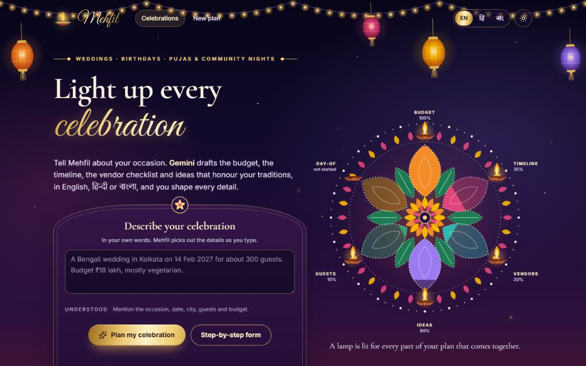
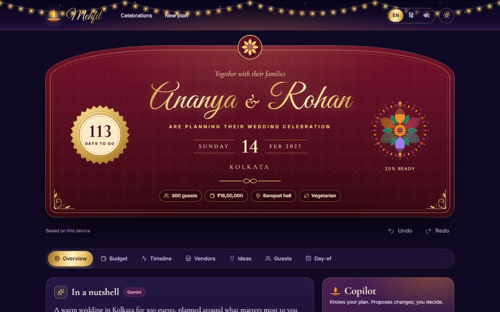

# Mehfil · the AI celebration planner

**Describe your celebration in one sentence. Gemini tailors a complete plan: a budget that adds
up, a timeline counted back from your date, a vendor checklist, ideas that honour your traditions,
a guest list and a day-of run sheet. You stay in control of every detail.**

Built for **PromptWars Virtual 2026 · Challenge 5: Celebration & Event Planner**.

- **Live app:** _added after deployment_
- **Demo video:** _added after recording_
- **Docs:** [Architecture](docs/ARCHITECTURE.md) · [How Gemini is used](docs/AI_DESIGN.md) ·
  [Security](SECURITY.md) · [Accessibility](docs/ACCESSIBILITY.md) · [Testing](docs/TESTING.md) ·
  [Design](docs/DESIGN.md) · [Deployment](docs/DEPLOYMENT.md) · [Decisions](docs/adr/)



## What it does

| The brief asks for                       | Mehfil                                                                                                                                                                                                                                                                                                                                    |
| ---------------------------------------- | ----------------------------------------------------------------------------------------------------------------------------------------------------------------------------------------------------------------------------------------------------------------------------------------------------------------------------------------- |
| A GenAI planning assistant               | Describe the occasion in your own words (English, Hindi, Bengali or a mix). Gemini reads it, and four plan sections are tailored in parallel and stream in as each one is ready. A **Copilot** that knows the plan proposes concrete edits ("we now expect 50 more guests") that you review and apply, with undo.                         |
| Weddings, birthdays and community events | Templates with Indian categories, rituals and lead times for weddings, birthdays and community events (pujas, festivals), plus anything else; a step-by-step form as an alternative to describing it.                                                                                                                                     |
| Budgets                                  | Amounts computed by code from Gemini's suggested split, always adding up to the total; planned, committed and paid per line; rebalance to a new total; "what if the guest count changes"; per-guest cost; realistic-or-not assessment and saving tips. Indian number grouping (₹18,00,000) and amounts typed as "18 lakh" or "1.5 crore". |
| Timelines                                | Tasks scheduled backwards from the date and pulled forward when time is short, grouped by phase, with due dates, priorities, filters and a countdown. Download a calendar file with reminders, or add any task to Google Calendar. A day-of run sheet for multi-day celebrations.                                                         |
| Vendor checklists                        | What to book and by when, with a status pipeline, questions to ask and red flags, quote comparison (the chosen quote counts in the budget), and a Google Maps search for each category in your city. Mehfil never invents vendors or phone numbers.                                                                                       |
| Personalised ideas                       | Themes with colour palettes, food, decor, entertainment, personal touches and favours shaped by your traditions, diet and budget. Keep the ones you like and ask for different ones in your own words.                                                                                                                                    |
| Beyond the brief                         | Guest list with RSVP and diet that feeds catering numbers (CSV import and export); an invitation writer in your tone, channel and language; readiness at a glance; plans that stay on the device, sync across devices with Google sign-in, and can be shared as a read-only link without personal details.                                |



## Gemini and other Google services

| Service                          | How Mehfil uses it                                                                                                                                                                                                                                                                                                                                                                                            |
| -------------------------------- | ------------------------------------------------------------------------------------------------------------------------------------------------------------------------------------------------------------------------------------------------------------------------------------------------------------------------------------------------------------------------------------------------------------- |
| **Gemini API** (`@google/genai`) | Five server-side tasks with JSON-schema structured output, function calling for the Copilot and streamed results: reading a description, tailoring budget, timeline, vendors and ideas, refining ideas, the Copilot, and writing invitations. `gemini-3.5-flash-lite` for structured sections and `gemini-3.5-flash` for ideas and the Copilot, each falling back to the other. [Details](docs/AI_DESIGN.md). |
| **Firebase Authentication**      | Anonymous sign-in behind AI calls and share links, and Google sign-in for sync. The server verifies Firebase ID tokens against Google's public keys.                                                                                                                                                                                                                                                          |
| **Cloud Firestore**              | Synced plans and share links through the lightweight `firestore/lite` SDK, protected by tested Security Rules.                                                                                                                                                                                                                                                                                                |
| **Google Calendar**              | "Add to Google Calendar" on every task, plus an `.ics` file with reminders.                                                                                                                                                                                                                                                                                                                                   |
| **Google Maps**                  | A search link for each vendor category in the event's city, so people find real vendors.                                                                                                                                                                                                                                                                                                                      |
| **Google Fonts**                 | Inter, Cormorant Garamond, Great Vibes, Noto Sans and Tiro for Devanagari and Bengali, self-hosted (no third-party requests).                                                                                                                                                                                                                                                                                 |

## How it meets the judging criteria

| Criterion             | What Mehfil does                                                                                                                                                                                                                                                                                                                          | Evidence                                                                                 |
| --------------------- | ----------------------------------------------------------------------------------------------------------------------------------------------------------------------------------------------------------------------------------------------------------------------------------------------------------------------------------------- | ---------------------------------------------------------------------------------------- |
| **Problem alignment** | Every part of the brief is a working, editable, persistent feature (table above), with Gemini doing real planning work rather than chat.                                                                                                                                                                                                  | `src/client/features/`, `e2e/plan.spec.ts`                                               |
| **Code quality**      | Strict TypeScript and `typescript-eslint` strict type-checked rules; one shared schema contract; one pure mutation path for every edit; dependency-injected server; typed i18n where a missing translation fails the build; documented decisions.                                                                                         | `src/shared/`, `eslint.config.js`, [ADRs](docs/adr/)                                     |
| **Security**          | Key only on the server; strict CSP with no inline code or `eval`; rate limits and Firebase token checks on AI calls; prompt-injection containment and output sanitising; tested Firestore rules; CSV-injection guard; secret scan in CI.                                                                                                  | [SECURITY.md](SECURITY.md), `firestore.rules`, `src/server/security/`                    |
| **Efficiency**        | AI suggests and code computes; sections stream in parallel; response cache and per-model request budget for the free tier; prerendered home page; routes, languages, Firebase and dialogs load on demand; Brotli; fonts by script. Lighthouse on a simulated phone (local): performance 87–90, accessibility, best practices and SEO 100. | [ARCHITECTURE.md](docs/ARCHITECTURE.md), [ADR 5](docs/adr/0005-prerender-and-hydrate.md) |
| **Testing**           | 680 unit, integration and component tests (97.3 % of lines), 13 emulator tests for the Firestore rules and Firebase adapter, and 38 browser journeys on desktop and phone, all in CI.                                                                                                                                                     | [TESTING.md](docs/TESTING.md)                                                            |
| **Accessibility**     | WCAG 2.2 AA: landmarks, focus management, labelled forms with an error summary, native dialogs, live announcements, tested contrast in both themes, reflow, reduced motion; axe in component and browser tests and a keyboard-only journey.                                                                                               | [ACCESSIBILITY.md](docs/ACCESSIBILITY.md)                                                |
| **Google services**   | Gemini, Firebase Authentication, Cloud Firestore, Google Calendar, Google Maps and Google Fonts.                                                                                                                                                                                                                                          | Table above                                                                              |

## Run it

```
npm ci
npm run dev
```

Open <http://localhost:5173>. Without a key the server runs in a labelled **demo mode** with
realistic sample answers. For real Gemini, create a free key in
[Google AI Studio](https://aistudio.google.com/apikey) and paste it after the `=` in
`.env.local` (git ignores this file):

```
GEMINI_API_KEY=
```

| Command                                                     | What it does                                                                 |
| ----------------------------------------------------------- | ---------------------------------------------------------------------------- |
| `npm run dev`                                               | API on port 8787 and the app on 5173, with hot reload                        |
| `npm run build` then `npm start`                            | Production build served by the Node server (precompressed, security headers) |
| `npm run lint`, `npm run typecheck`, `npm run format:check` | Static checks                                                                |
| `npm test`, `npm run test:coverage`                         | Unit, integration and component tests (with coverage gates)                  |
| `npm run e2e`                                               | Browser journeys on desktop and phone (after a build)                        |
| `npm run test:rules`                                        | Firestore rules and Firebase adapter on the emulators (needs Java 21)        |
| `npm run eval`                                              | Checks real Gemini answers against sample celebrations (needs a key)         |

Deployment to Vercel and Firebase, all on free tiers: [docs/DEPLOYMENT.md](docs/DEPLOYMENT.md).

## Privacy

Plans are saved in your browser. Signing in with Google copies them to Firestore, readable only by
your account. Guest names and contacts never leave the device for the AI, shared links never
include them, and you can delete your cloud data and your local plans from the account menu.

## License

[MIT](LICENSE)
