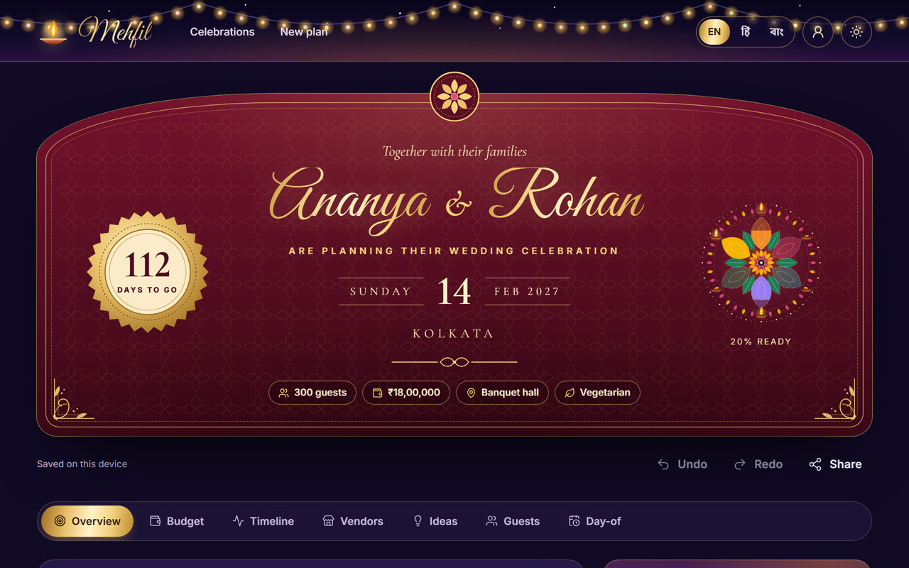
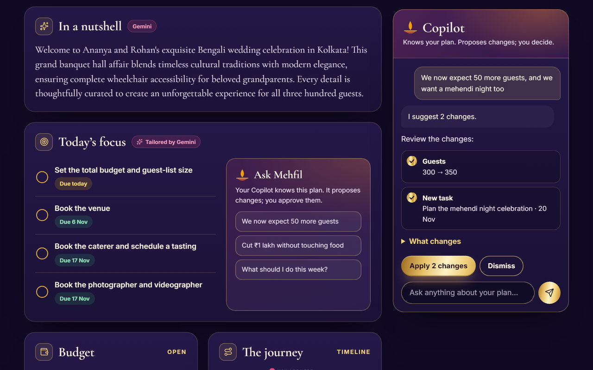
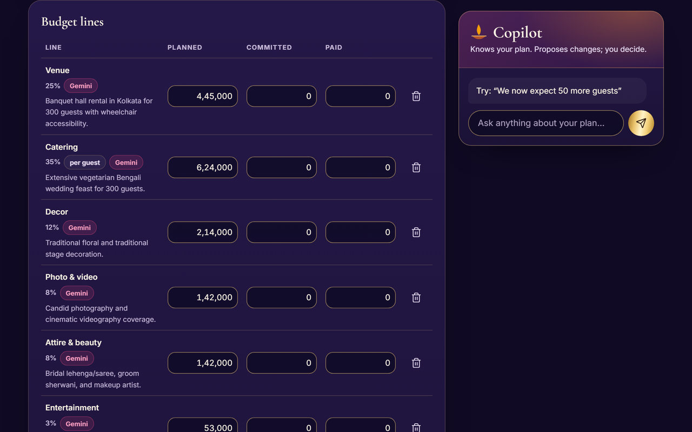
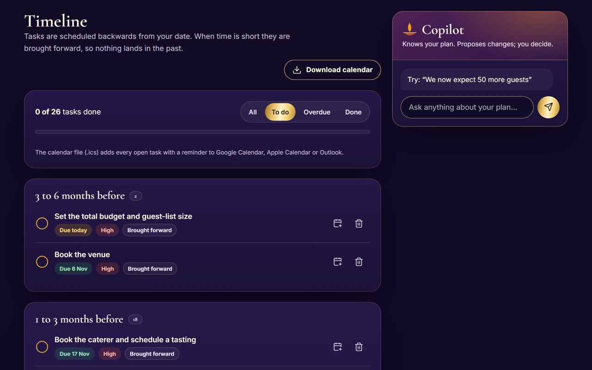
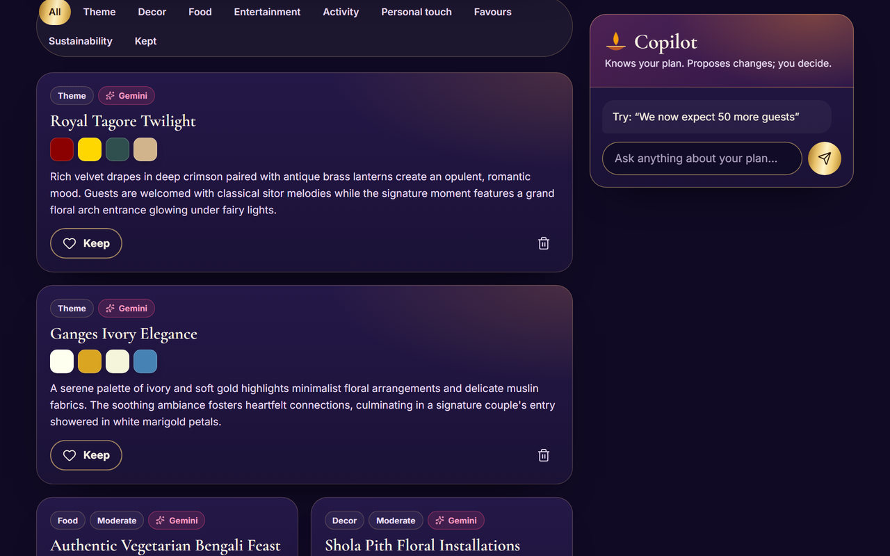
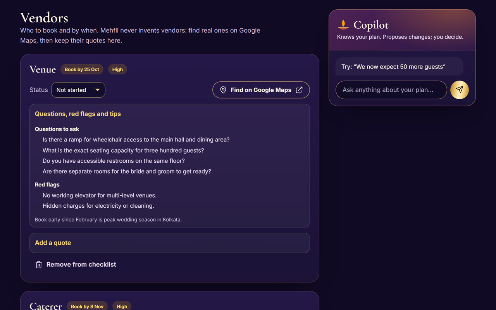
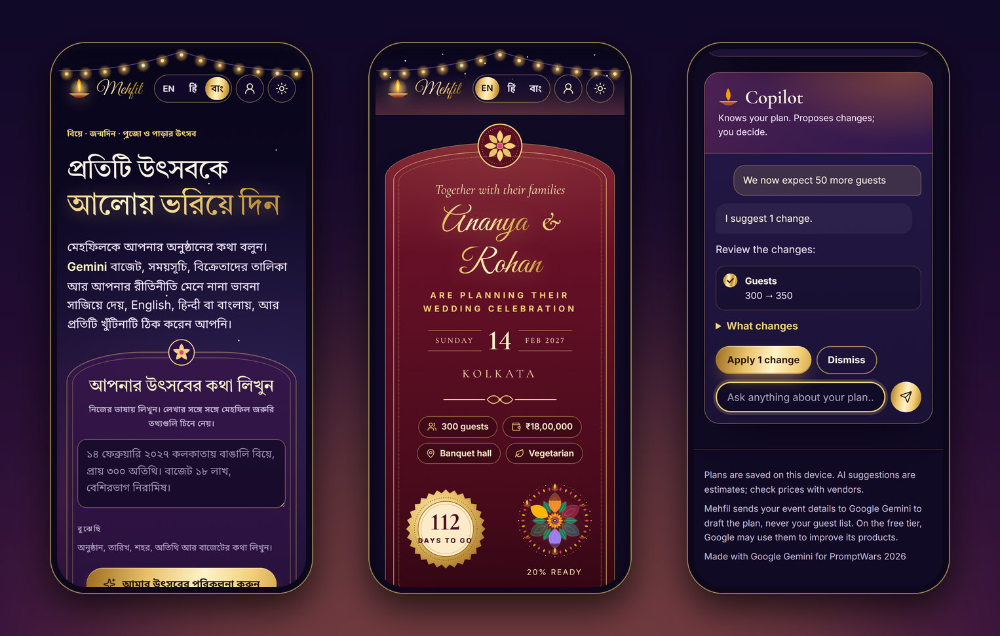
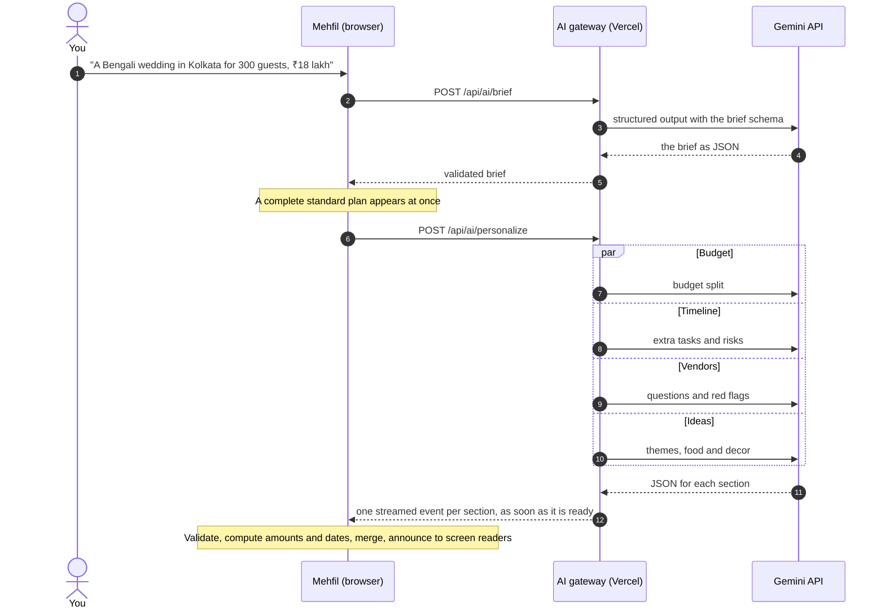
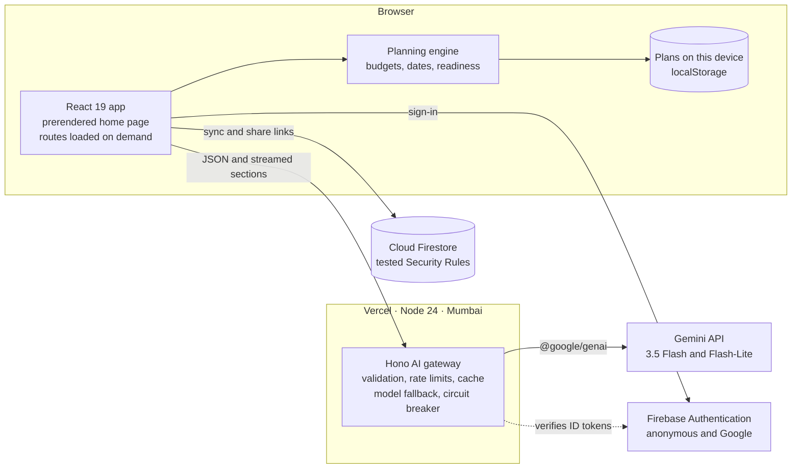

<div align="center">


# Mehfil

**The AI planner for weddings, birthdays and community celebrations.**

Describe your celebration in one sentence, in English, Hindi or Bengali. Gemini turns it into a
complete plan: a budget that adds up, a timeline counted back from your date, a vendor checklist,
ideas that honour your traditions and a run sheet for the day. Every detail stays yours to change.

[](https://github.com/roybishal362/Mehfil/actions/workflows/ci.yml)
[](https://github.com/roybishal362/Mehfil/actions/workflows/codeql.yml)
[](docs/TESTING.md)
[](docs/TESTING.md)
[](docs/ACCESSIBILITY.md)
[](LICENSE)

[](docs/AI_DESIGN.md)
[](firestore.rules)
[](src/client)
[](tsconfig.base.json)
[](docs/DEPLOYMENT.md)

[Why Mehfil](#why-mehfil) · [Screenshots](#screenshots) · [Features](#features) ·
[How Gemini is used](#how-gemini-is-used) · [Architecture](#architecture) · [Quality](#quality) ·
[Run it locally](#run-it-locally) · [Docs](#documentation)

<sub>Built for <b>PromptWars Virtual 2026 · Challenge 5: Celebration &amp; Event Planner</b></sub>

</div>

## Why Mehfil

Planning a celebration in India means hundreds of decisions: an ₹18 lakh budget split across a
dozen vendors, rituals that each need their own preparation, 300 guests with different diets, and
dates that keep moving. Generic checklists don't know any of that, and a chatbot forgets your plan
after one answer. Mehfil keeps Gemini working **on** the plan.

- **Gemini plans, code does the maths.** Gemini reads your description and tailors four parts of
  the plan at once, streaming each one as it lands. Every amount and date is then computed by
  tested code, so budgets always add up and no deadline lands in the past.
- **A Copilot that edits the plan, not just chats.** Say "we now expect 50 more guests" and
  Gemini's function calling proposes the exact changes: the guest count, a task, a budget line.
  Apply the ones you want, and undo any of them later.
- **Made for Indian celebrations.** Rituals, lead times and vendors for weddings, birthdays,
  pujas and festivals. Amounts in lakh and crore (₹18,00,000), typed the way people say them
  ("18 lakh", "1.5 crore"), and the whole app in English, Hindi and Bengali.
- **Yours, on every device.** Plans are saved on your device first. Sign in with Google to sync
  them, or share a read-only link that leaves out guests and contacts.
- **Free to run.** Vercel Hobby, Firebase Spark and the Gemini free tier, with caching, model
  fallback and rate limits that keep it answering within free quotas.

## Screenshots

The plan below was tailored by real Gemini from one sentence: _"A Bengali wedding of Ananya and
Rohan in Kolkata on 14 Feb 2027 for about 300 guests. Budget ₹18 lakh, mostly vegetarian, and my
grandparents need wheelchair access."_

<table>
  <tr>
    <td width="50%" valign="top">
      
      <p><b>Every plan opens as an invitation.</b> A countdown seal, the key facts, and a rangoli that fills in as the plan gets ready.</p>
    </td>
    <td width="50%" valign="top">
      
      <p><b>The Copilot proposes, you decide.</b> "We now expect 50 more guests, and we want a mehendi night too" becomes two changes to review, apply or dismiss.</p>
    </td>
  </tr>
  <tr>
    <td width="50%" valign="top">
      
      <p><b>A budget that adds up.</b> Gemini suggests each line's share and why; code computes every rupee, so the lines always meet the total.</p>
    </td>
    <td width="50%" valign="top">
      
      <p><b>A timeline counted back from the date.</b> Grouped by how far ahead each task falls, brought forward when time is short, and exported to any calendar with reminders.</p>
    </td>
  </tr>
  <tr>
    <td width="50%" valign="top">
      
      <p><b>Ideas that fit your traditions.</b> Themes with colour palettes, food, decor and personal touches. Keep the ones you love; ask for different ones in your own words.</p>
    </td>
    <td width="50%" valign="top">
      
      <p><b>Vendors, never made up.</b> What to book and by when, Gemini's questions and red flags, and a Google Maps search for real vendors in your city.</p>
    </td>
  </tr>
  <tr>
    <td width="50%" valign="top">
      
      <p><b>English, Hindi and Bengali.</b> The whole interface switches language, and Gemini can write the plan in 16 languages.</p>
    </td>
    <td width="50%" valign="top">
      
      <p><b>Night and day themes.</b> Both are checked for colour contrast in the tests.</p>
    </td>
  </tr>
</table>

<p align="center">
  
</p>
<p align="center"><sub>On a phone: the home page in Bengali, a wedding plan, and the Copilot suggesting a change.</sub></p>

## Features

| The brief asks for                           | What Mehfil does                                                                                                                                                                                                                                                                                                    |
| -------------------------------------------- | ------------------------------------------------------------------------------------------------------------------------------------------------------------------------------------------------------------------------------------------------------------------------------------------------------------------- |
| **A GenAI planning assistant**               | Describe the occasion in your own words (English, Hindi, Bengali or a mix) or use a three-step form. Gemini tailors the plan section by section, and the Copilot turns requests into reviewable edits with undo.                                                                                                    |
| **Weddings, birthdays and community events** | Templates with Indian categories, rituals and lead times for weddings, birthdays and community events such as pujas and festivals, and a general template for anything else.                                                                                                                                        |
| **Budgets**                                  | Gemini's suggested split, turned into amounts by code that always add up; planned, committed and paid per line; rebalance to a new total; "what if the guest count changes"; cost per guest; a realistic-or-not check with saving tips. Indian grouping (₹18,00,000) and amounts typed as "18 lakh" or "1.5 crore". |
| **Timelines**                                | Tasks scheduled back from the date and brought forward when time is short, grouped by phase, with priorities, filters and a countdown. A calendar file with reminders, "Add to Google Calendar" on every task, and a printable day-of run sheet for multi-day celebrations.                                         |
| **Vendor checklists**                        | What to book and by when, a status pipeline from "not started" to "paid", questions to ask and red flags, quote comparison (the chosen quote counts in the budget), and a Google Maps search for each category in your city.                                                                                        |
| **Personalised ideas**                       | Themes with colour palettes, food, decor, entertainment, activities, personal touches, favours and greener choices, shaped by your traditions, diets and budget. Keep the ones you like; ask for different ones in your own words.                                                                                  |
| **Beyond the brief**                         | A guest list with RSVPs and diets that feeds catering numbers (CSV import and export), an invitation writer for WhatsApp, email, cards and social posts, readiness at a glance, sync across devices, and read-only share links.                                                                                     |

## How Gemini is used

Gemini does the planning work in five server-side tasks. Every answer is constrained by a JSON
schema generated from the same Zod schemas the app uses, then validated, clamped and cleaned before
it reaches the plan.

| Task                   | What Gemini does                                                                                                                                                           | Model                                                                | Gemini features                                       |
| ---------------------- | -------------------------------------------------------------------------------------------------------------------------------------------------------------------------- | -------------------------------------------------------------------- | ----------------------------------------------------- |
| **Read a description** | Turns a sentence in English, Hindi, Bengali or a mix into a structured brief, and asks one question when something essential is missing.                                   | 3.5 Flash-Lite                                                       | Structured output                                     |
| **Tailor the plan**    | Budget split with reasons, extra tasks and risks, vendor questions and red flags, themed ideas. Four sections run in parallel and each is streamed as soon as it is ready. | 3.5 Flash-Lite for budget, timeline and vendors; 3.5 Flash for ideas | Structured output, parallel calls, streaming (NDJSON) |
| **Refine ideas**       | New ideas from a chip ("More budget-friendly") or your own words, keeping the ones you liked.                                                                              | 3.5 Flash                                                            | Structured output                                     |
| **Copilot**            | Proposes typed edits through 10 tools: tasks, budget lines and total, guest count, vendors, ideas and the run sheet.                                                       | 3.5 Flash                                                            | Function calling                                      |
| **Invitation writer**  | Drafts invitations in your tone (warm, formal, playful, traditional), for WhatsApp, email, a card or social media, in your language.                                       | 3.5 Flash-Lite                                                       | Structured output                                     |



**Guardrails**

- **AI suggests, code computes.** Gemini returns bounded percentages and day offsets; the planning
  engine turns them into rupees (largest-remainder rounding, so lines sum exactly) and dates.
- **No invented facts.** There are no schema fields for vendor names, phone numbers or prices, the
  prompts forbid them, and a filter strips phone numbers, emails and links. Real vendors come from
  Google Maps searches built by code.
- **Prompt injection is contained.** User text is passed as clearly marked, untrusted data; answers
  must match a schema; the Copilot can only propose typed operations on IDs that exist, and nothing
  changes until you apply it.
- **Diets are spelled out.** Each prompt states what every requested diet rules out (Jain means no
  onion, garlic, potato or other root vegetables), so dishes stay within them.
- **Reliable on the free tier.** A 30-minute response cache, a per-model request budget, one
  jittered retry, automatic fallback to the other model, a circuit breaker (three failures pause a
  model for 60 seconds) and, if Gemini is unavailable, a clearly labelled standard plan.
- **Private by design.** Guest names and contacts never reach Gemini; only counts do.
- **Evaluated against real Gemini.** `npm run eval` runs six celebrations, including descriptions
  in Hindi and Bengali, a Jain dinner and a short-notice party. On 24 October 2026 all six passed
  every check: valid structured answers, budgets that add up, dates before the event, no contact
  details, diets respected and text in the requested language.

More in [docs/AI_DESIGN.md](docs/AI_DESIGN.md).

## Architecture

One TypeScript codebase. Vercel serves the React app from its CDN and runs the AI gateway as a
Node function in Mumbai; Firebase holds identity and synced data.



Key decisions, each recorded as an [architecture decision record](docs/adr/):

1. [Free hosting](docs/adr/0001-free-hosting.md) on Vercel Hobby, Firebase Spark and the Gemini
   free tier, with no billing account anywhere.
2. [AI suggests, code computes](docs/adr/0002-ai-suggests-code-computes.md): money and dates are
   never left to the model.
3. [`generateContent` with JSON schemas](docs/adr/0003-generate-content-with-json-schema.md)
   behind a provider interface, with a deterministic demo provider for tests and key-less runs.
4. [Local-first plans](docs/adr/0004-local-first-sync.md), with opt-in sync through Google
   sign-in and conflicts the user settles.
5. [A prerendered, hydrated home page](docs/adr/0005-prerender-and-hydrate.md) for a fast first
   paint under a strict Content Security Policy.

The full picture, including the data model and the request pipeline, is in
[docs/ARCHITECTURE.md](docs/ARCHITECTURE.md).

## Google services

| Service                          | How Mehfil uses it                                                                                                                                                                                |
| -------------------------------- | ------------------------------------------------------------------------------------------------------------------------------------------------------------------------------------------------- |
| **Gemini API** (`@google/genai`) | Five server-side tasks with JSON-schema structured output, function calling for the Copilot and streamed results; `gemini-3.5-flash` and `gemini-3.5-flash-lite`, each falling back to the other. |
| **Firebase Authentication**      | Anonymous sign-in behind AI calls and share links, and Google sign-in for sync. The server verifies Firebase ID tokens against Google's public keys.                                              |
| **Cloud Firestore**              | Synced plans and share links through the lightweight `firestore/lite` SDK, protected by Security Rules that are tested on the emulator.                                                           |
| **Google Calendar**              | "Add to Google Calendar" on every task, plus a calendar file with reminders for any calendar app.                                                                                                 |
| **Google Maps**                  | A search link for each vendor category in the event's city, so people find real vendors.                                                                                                          |
| **Google Fonts**                 | Inter, Cormorant Garamond, Great Vibes, Noto Sans and Tiro for Devanagari and Bengali, self-hosted, with each script's font loaded only when it is used.                                          |

## Quality

| Check                                                                                             | Result                                                                                        |
| ------------------------------------------------------------------------------------------------- | --------------------------------------------------------------------------------------------- |
| Unit, integration and component tests (Vitest, Testing Library, jest-axe, fast-check)             | **684 passing**; 97.35 % of lines and 88.57 % of branches covered, with per-layer gates in CI |
| Firestore Security Rules and the Firebase adapter (emulator)                                      | **13 passing**                                                                                |
| Browser journeys (Playwright on desktop and a phone, axe on every page, reflow at 390 and 320 px) | **38 passing**                                                                                |
| Gemini evaluation (six sample celebrations, real API)                                             | **6 of 6** pass every check                                                                   |
| Lighthouse (simulated phone, local)                                                               | Performance 87–90 · Accessibility 100 · Best practices 100 · SEO 100                          |
| Static analysis                                                                                   | Strict TypeScript, typescript-eslint strict type-checked rules, jsx-a11y, CodeQL, secret scan |

Every push runs the full pipeline in [GitHub Actions](.github/workflows/ci.yml): secret scan, size
budget, lint, formatting, type checks and tests with coverage gates on Node 22 and 24, then the
production build, browser journeys, Firestore rules on the emulator, Lighthouse budgets and a
dependency audit. Details in [docs/TESTING.md](docs/TESTING.md).

## How it meets the judging criteria

| Criterion             | What Mehfil does                                                                                                                                                                                                                                                                    | Evidence                                                                                 |
| --------------------- | ----------------------------------------------------------------------------------------------------------------------------------------------------------------------------------------------------------------------------------------------------------------------------------- | ---------------------------------------------------------------------------------------- |
| **Problem alignment** | Every part of the brief is a working, editable, saved feature (see [Features](#features)), with Gemini doing real planning work rather than chat.                                                                                                                                   | `src/client/features/`, `e2e/plan.spec.ts`                                               |
| **Code quality**      | Strict TypeScript and strict type-checked lint rules; one shared schema contract for browser, server and Gemini; one pure function for every edit, so undo is free; a dependency-injected server; typed translations, where a missing string fails the build; documented decisions. | `src/shared/`, `eslint.config.js`, [ADRs](docs/adr/)                                     |
| **Security**          | The key stays on the server; a strict CSP with no inline code or `eval`; rate limits and Firebase token checks on AI calls; prompt-injection containment and output cleaning; tested Firestore rules; a CSV-injection guard; a secret scan in CI.                                   | [SECURITY.md](SECURITY.md), `firestore.rules`, `src/server/security/`                    |
| **Efficiency**        | AI suggests and code computes; sections stream in parallel; a response cache and per-model request budget for the free tier; a prerendered home page; routes, languages, Firebase and dialogs load on demand; Brotli; fonts per script.                                             | [ARCHITECTURE.md](docs/ARCHITECTURE.md), [ADR 5](docs/adr/0005-prerender-and-hydrate.md) |
| **Testing**           | 684 unit, integration and component tests (97.35 % of lines), 13 emulator tests for the Firestore rules and Firebase adapter, 38 browser journeys on desktop and phone, and an evaluation against real Gemini.                                                                      | [TESTING.md](docs/TESTING.md)                                                            |
| **Accessibility**     | WCAG 2.2 AA: landmarks, focus management, labelled forms with an error summary, native dialogs, live announcements, tested contrast in both themes, reflow down to 320 px, reduced motion; axe in component and browser tests, and a keyboard-only journey.                         | [ACCESSIBILITY.md](docs/ACCESSIBILITY.md)                                                |
| **Google services**   | Gemini, Firebase Authentication, Cloud Firestore, Google Calendar, Google Maps and Google Fonts.                                                                                                                                                                                    | [Google services](#google-services)                                                      |

## Run it locally

You need [Node.js](https://nodejs.org/) 22.12 or newer.

```bash
git clone https://github.com/roybishal362/Mehfil.git
cd Mehfil
npm ci
npm run dev
```

Open <http://localhost:5173>. Without a key, the server runs a clearly labelled **demo mode** with
realistic sample answers, so every feature can be tried. For real Gemini, create a free key in
[Google AI Studio](https://aistudio.google.com/apikey), copy `.env.example` to `.env.local` (git
ignores it) and paste the key after the `=`:

```bash
GEMINI_API_KEY=
```

| Command                                                     | What it does                                                                 |
| ----------------------------------------------------------- | ---------------------------------------------------------------------------- |
| `npm run dev`                                               | API on port 8787 and the app on 5173, with hot reload                        |
| `npm run build` then `npm start`                            | Production build served by the Node server (precompressed, security headers) |
| `npm run lint`, `npm run typecheck`, `npm run format:check` | Static checks                                                                |
| `npm test`, `npm run test:coverage`                         | Unit, integration and component tests (with coverage gates)                  |
| `npm run e2e`                                               | Browser journeys on desktop and phone (after a build)                        |
| `npm run test:rules`                                        | Firestore rules and the Firebase adapter on the emulators (needs Java 21)    |
| `npm run eval`                                              | Checks real Gemini answers against sample celebrations (needs a key)         |

<details>
<summary><b>Configuration</b></summary>

All variables are read by the server only; nothing here is bundled into the browser.

| Variable                                                                             | Purpose                                                                                   |
| ------------------------------------------------------------------------------------ | ----------------------------------------------------------------------------------------- |
| `GEMINI_API_KEY`                                                                     | Real Gemini answers. Without it, the labelled demo mode runs.                             |
| `FIREBASE_PROJECT_ID`, `FIREBASE_API_KEY`, `FIREBASE_AUTH_DOMAIN`, `FIREBASE_APP_ID` | Sign-in, sync and share links. This web config is public by design and served at runtime. |
| `GEMINI_MODEL_SMART`, `GEMINI_MODEL_FAST`                                            | Model choice; defaults `gemini-3.5-flash` and `gemini-3.5-flash-lite`.                    |
| `AI_RATE_LIMIT`                                                                      | AI tokens per visitor per 10 minutes (default 24; a tailored plan costs 4).               |
| `AI_MAX_RPM`                                                                         | Gemini calls per minute per server instance (default 12), to stay within the free tier.   |
| `REQUIRE_AUTH_FOR_AI`                                                                | Require a Firebase ID token on AI calls; on by default when Firebase is configured.       |

</details>

Deploying is free: Vercel Hobby for the app and the AI gateway, Firebase Spark for sign-in and
Firestore, and a Gemini key from AI Studio. Step by step: [docs/DEPLOYMENT.md](docs/DEPLOYMENT.md).

## Project structure

```text
src/
├── shared/          One contract for browser, server and Gemini
│   ├── schemas/     Zod schemas, also turned into Gemini's JSON schemas
│   ├── domain/      Planning engine: budgets, timelines, vendors, readiness, edits, merging
│   ├── templates/   Weddings, birthdays, community events and more: categories, rituals, lead times
│   └── export/      Calendar files, Google Calendar and Maps links, CSV, share snapshots
├── server/          Hono AI gateway
│   ├── ai/          Gemini and demo providers, prompts, tasks, the gateway (cache, fallback)
│   ├── middleware/  Request context, client IP, rate limits, Firebase token checks
│   └── security/    One header policy for the Node server and Vercel
└── client/          React app
    ├── app/         Shell, routes, themes and notifications
    ├── pages/       Home, new plan, plan workspace, shared plan
    ├── features/    Plan sections, overview, Copilot, account, sync and sharing
    ├── cloud/       Firebase adapter, sync with conflict handling, share links
    ├── state/       Plans with undo and redo, saved on the device
    └── i18n/        English, Hindi and Bengali, typed so a missing string fails the build
e2e/                 Playwright journeys with axe
evals/               Evaluation against real Gemini
scripts/             Build, prerender, Vercel output, secret scan, size budget
docs/                Architecture, AI design, accessibility, testing, design, deployment, ADRs
firestore.rules      Owner-only plans; share links readable by ID only until they expire
```

## Security and privacy

- The Gemini key lives only in the server's environment, and CI scans every file for keys.
- A strict Content Security Policy: scripts only from this origin, no inline code and no `eval`.
- AI calls are rate limited per visitor and, with Firebase on, need a verified Firebase ID token.
- Firestore rules let each account read and write only its own plans, with every field checked.
- Share links use 128-bit IDs, expire after 90 days and never include guests or contacts.
- Guest names and contacts never leave the device for the AI, and you can delete your cloud data
  and your local plans from the account menu.

The threat model, with evidence for each item, is in [SECURITY.md](SECURITY.md).

## Accessibility and languages

- Built to WCAG 2.2 AA: landmarks, a skip link, focus moved to each new page's heading, labelled
  forms with an error summary, native dialogs and announcements for streamed AI results.
- Colour contrast is checked in code for both themes; motion stops with `prefers-reduced-motion`.
- No sideways scrolling down to 320 px, checked in the browser tests.
- The interface is in English, Hindi and Bengali, and AI-written text carries its own `lang`, so
  screen readers pronounce it correctly.

Details in [docs/ACCESSIBILITY.md](docs/ACCESSIBILITY.md).

## Documentation

| Document                                    | What it covers                                                     |
| ------------------------------------------- | ------------------------------------------------------------------ |
| [Architecture](docs/ARCHITECTURE.md)        | Components, data model, request pipeline and performance           |
| [How Mehfil uses Gemini](docs/AI_DESIGN.md) | Tasks, prompts, schemas, guardrails, resilience and the evaluation |
| [Security](SECURITY.md)                     | Threat model with evidence, data and privacy                       |
| [Accessibility](docs/ACCESSIBILITY.md)      | WCAG 2.2 AA approach and how it is tested                          |
| [Testing](docs/TESTING.md)                  | Test layers, coverage gates and how to run each suite              |
| [Design](docs/DESIGN.md)                    | The festival-of-lights visual language, tokens and motion          |
| [Deployment](docs/DEPLOYMENT.md)            | Free deployment on Vercel and Firebase, step by step               |
| [Decisions](docs/adr/)                      | Architecture decision records                                      |
| [AGENTS.md](AGENTS.md)                      | Conventions for AI coding agents and new contributors              |

## Acknowledgements

Built for **PromptWars Virtual 2026** by Hack2skill and Google for Developers. Fonts come from
Google Fonts through Fontsource (SIL Open Font License) and icons from Lucide (ISC License).

## License

[MIT](LICENSE) © 2026 Bishal Roy
