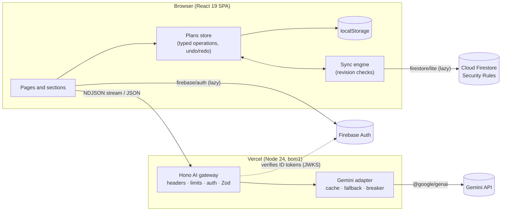

# Architecture

Mehfil is one TypeScript codebase in three parts: a **shared planning engine** used by both sides,
a **Hono AI gateway** that is the only thing allowed to talk to Gemini, and a **React app** that
works offline-first and loads cloud features on demand.



## The principle: AI suggests, code computes

The model never produces a total, a date or a phone number. It returns bounded percentages, day
offsets, ideas and wording; the deterministic engine in `src/shared/domain` turns those into money
(largest-remainder rounding, so lines always add up to the total) and dates (scheduled backwards
from the event and pulled forward when time is short). The same engine builds the instant
baseline plan before any AI call, so the app is useful even when Gemini is unavailable.

Every change to a plan, from a form field, an AI merge or a Copilot proposal, is a typed
`PlanOperation` validated with Zod and applied by one pure function, `applyOperations`. That gives
one tested path for every mutation, undo and redo for free, and a safe way to let the Copilot act:
it can only propose operations on IDs that exist, and nothing changes until the user applies them.

## Layout

```
src/shared/     Used by the server and the browser
  schemas/      Zod schemas: brief, plan, operations, AI requests and responses (one source of truth)
  domain/       Budget, timeline, vendors, guests, readiness, operations, AI merges, quick parsing
  templates/    India-aware categories and lead times for weddings, birthdays and community events
  export/       .ics calendars, Google Calendar and Maps links, CSV, share snapshots
  zod.ts        The only way to import Zod (turns off its eval-based parsers for the CSP)
src/server/     Hono app (createApp with injected dependencies)
  middleware/   Request IDs, security headers, rate limits, Firebase ID token checks
  ai/           Provider interface, Gemini and mock providers, gateway, prompts
    tasks/      One module per AI task: brief, sections, invitation, Copilot (and its tools)
    mock/       Deterministic demo answers, one module per task (demo mode and tests)
  routes/       /api/health, /api/config, /api/ai/*
  node.ts       Node entry (local, Docker); vercel.ts: Vercel function entry
src/client/     React app
  app/          Shell, routing and focus, theme, runtime config, feedback (toasts, live region)
  pages/        Home, step-by-step form, plan, shared plan
  features/     Home, plan sections, overview, Copilot, cloud (account, share, conflicts)
  state/        Plans store, local persistence, AI runs
  cloud/        Lazy Firebase adapter, sync engine, share links, account actions
  i18n/         English, Hindi and Bengali dictionaries (typed; a missing string fails the build)
scripts/        Builds: server bundle, Vercel output, prerender, compression; repo checks
tests/          Firestore Security Rules tests (emulator)
e2e/            Playwright journeys with axe
```

## Requests

- `GET /api/health` and `GET /api/config` are public. The config response tells the browser
  whether AI runs on Gemini or in demo mode and gives the public Firebase web config, so one build
  works with or without Firebase.
- `POST /api/ai/brief | personalize | refine | copilot | invitation` pass through: request ID,
  security headers, a 32 KB body limit, a per-visitor rate limit (AI calls cost more), optional or
  required Firebase ID token verification, then Zod validation of the body.
- `personalize` streams **NDJSON**: four plan sections run in parallel (budget; timeline, run
  sheet and risks; vendors; ideas and summary), and each arrives as one line as soon as it is
  ready. The browser merges each with a pure function and announces it to screen readers; a
  failed section shows "Retry" without blocking the rest.

## Gemini gateway

`src/server/ai/gateway.ts` wraps every model call with:

- an **LRU cache with TTL** keyed by a SHA-256 of task, prompt version, model and input, with
  in-flight de-duplication;
- a **per-model request budget** under the free-tier per-minute limit;
- one retry with jitter, then the **other model**, then the deterministic plan;
- a **circuit breaker** per model that pauses calls after repeated failures and lets a single
  trial call through when it reopens;
- an overall **deadline**, and cancellation when the browser goes away.

## Browser

- **Local-first.** Plans live in a Zustand store persisted to `localStorage` (validated on read;
  damaged entries are kept aside, never crash the app). Saving never waits for the network.
- **Fast first screen.** The English home page is prerendered into `index.html` at build time and
  hydrated in a React transition; other pages and languages render on the client. Routes, the Hindi
  and Bengali dictionaries, Firebase and the dialogs are separate chunks loaded on demand.
- **Cloud on demand.** `firebase/auth` and `firebase/firestore/lite` load only for a sign-in, a
  share link, an AI call that needs an account, or a returning Google user.
- **Sync.** Each plan carries a revision that only goes up. A device remembers the revision it last
  synced; a pure `reconcile` step compares both copies with it to copy one-sided changes, follow
  deletions without losing newer work, and surface real conflicts to the user. Pushes are
  transactions that fail if the cloud copy changed in the meantime.

## Deployment

Vercel's Build Output API serves `dist/client` from the CDN and the Hono app as one Node.js
function in Mumbai (`bom1`) with streaming. Security headers come from one policy module used by
both the Node server and the generated Vercel routes. See [DEPLOYMENT.md](DEPLOYMENT.md).
